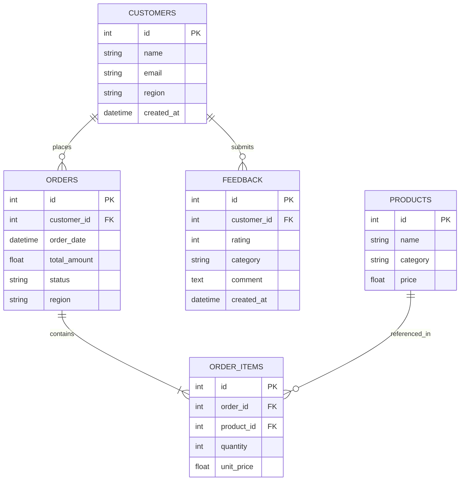

Live Link:https://business-insights-business-analytic.vercel.app/
# BusinessInsights – Business Analytics & Decision Support Dashboard

[](https://fastapi.tiangolo.com)
[](https://react.dev)
[](https://tailwindcss.com)
[](https://sqlite.org)
[](#)

A centralized, enterprise-grade Business Analytics and Decision Support Dashboard built for business owners, executives, and business analysts. This application transforms raw transactional, operational, and customer review data into clear visualizations, actionable insights, and prioritized strategic recommendations.

Developed as part of the **ITOrizon Business Analyst Hiring Assignment**.

---

## 1. Project Introduction

In today's competitive landscape, businesses generate vast streams of data across transactions, supply chains, regional operations, and customer support channels. However, raw data alone does not drive growth: without systematic analysis, critical business problems such as subtle revenue contraction, inventory stagnation, logistics bottlenecks, and customer churn remain hidden until they impact the bottom line.

**BusinessInsights** serves as a centralized decision support cockpit that automates data aggregation, calculates core performance indicators, identifies operational bottlenecks using transparent mathematical rules, and generates prioritized tactical action plans for executive management.

---

## 2. Business Problem Statement

Business owners and executive managers frequently struggle with the following critical questions:

1. **Revenue Dynamics**: How much revenue is the business generating in the current period, and is it expanding or contracting compared to prior baselines?
2. **Product Profitability & Velocity**: Which products drive top-line revenue, and which items are stagnant inventory causing carrying cost drag?
3. **Geographic Distribution**: Which regional markets are outperforming, and where are we under-penetrated?
4. **Customer Lifetime Behavior**: What percentage of customers are high-value recurring buyers versus one-time buyers at risk of churn?
5. **Customer Satisfaction & Complaints**: Are customer complaints escalating, and which root causes (e.g., delivery delays vs. product defects) drive negative reviews?
6. **Decision Support & Actionability**: What specific operational steps should management, sales, logistics, and customer success teams execute next?

---

## 3. Project Objectives

- **Executive Visibility**: Provide real-time visibility into Total Revenue, Total Orders, Total Customers, Average Order Value (AOV), Revenue Growth %, and Customer Satisfaction (CSAT).
- **Interactive Multidimensional Filtering**: Enable dynamic slice-and-dice by timeline (Last 7 Days, Last 30 Days, Last 90 Days, This Year, All Time, Custom Date Range) and geographic regions.
- **Transparent Customer Segmentation**: Group customer accounts into High Value, Regular, New, and At Risk cohorts using clear, deterministic transaction criteria.
- **Data-Driven Problem Identification**: Flag business problems (revenue contraction, CSAT degradation, inventory drag, regional imbalance, churn risk) using mathematical calculations rather than opaque black-box assertions.
- **Actionable Decision Engine**: Connect each identified problem to a concrete recommendation containing department ownership, implementation effort, and projected ROI.
- **Strict Data Pipeline**: Provide an industrial-grade CSV import/export pipeline that previews records, flags missing headers, identifies null cells and duplicates, and protects data integrity.

---

## 4. Key Application Features

### A. Executive Dashboard Module
- **6 KPI Metric Cards**: Total Revenue, Total Orders, Total Registered Customers, Average Order Value, Revenue Growth %, and Customer CSAT (out of 5.0).
- **Interactive Visualizations**:
  - *Monthly Revenue Trend* (Area / Line Chart with dual metric tooltips).
  - *Sales by Product Category* (Horizontal Bar Chart).
  - *Revenue by Region* (Pie / Donut Chart with percentage contributions).
  - *Customer Segmentation Cohorts* (Donut Chart).
  - *Order Fulfillment Distribution* (Completed, Processing, Cancelled, Refunded).
  - *Monthly Customer Acquisition Trajectory* (Cumulative Growth Curve).
- **Date & Region Filtering**: Live filtering with instant chart and KPI re-renders.

### B. Sales Analytics Module
- Complete transaction log with full search by Order ID or Customer Name.
- Filter by Product Category, Geographic Region, and Order Fulfillment Status.
- Multi-column sorting (by Revenue or Order Date, Ascending/Descending).
- Filtered revenue total and dynamic Average Order Value computation.
- Top 5 Best-Selling Products vs. Bottom 5 Low-Performing Products analysis.
- Line items modal showing product breakdown, quantities, and unit prices.
- Instant CSV export of filtered sales records.

### C. Customer Analytics Module
- Macro KPIs: Total Customers, First-Time Buyers, Returning Buyers, Purchase Frequency (orders/customer), Average Customer Lifetime Spend.
- Customer Segmentation Framework:
  - **High Value**: Total spend &ge; $2,000 OR (&ge; 4 orders with spend &ge; $1,000).
  - **Regular**: &ge; 2 orders with spend between $300 and $2,000.
  - **New**: Account created within last 60 days or total orders &le; 1.
  - **At Risk**: Last order &gt; 90 days ago OR prior refunded order / negative review (&le; 2 stars).
- Paginated customer table with search, regional filtering, and segment filtering.
- One-click Customer Analytics CSV report download.

### D. Business Problem Identification & Decision Engine
- **Calculated Problem Detection**:
  - *Revenue Contraction Rule*: Period-over-period percentage comparison with priority scaling.
  - *Customer Dissatisfaction Rule*: CSAT &lt; 3.8 / negative review share &gt; 15% with root-cause complaint category isolation.
  - *Inventory Stagnation Rule*: Identification of products with revenue contribution &lt; 10% of top-seller.
  - *Regional Disparity Rule*: Detection of geographic regions generating &lt; 15% share with disparity ratio.
  - *Customer Churn Risk Rule*: Detection of dormant customer cohorts with historical revenue at stake.
- **Executive Decision Matrix**:
  - Detailed supporting data, business impact, and recommended action for each problem.
  - Priority levels (*High*, *Medium*, *Low*).
  - Action plan checklists, department assignments (*Sales & Marketing*, *Operations*, *Customer Success*, *Product*), and effort categorization (*Quick Win*, *Medium Effort*, *Strategic Project*).
- One-click executive action plan CSV export.

### E. Customer Feedback & CSAT Module
- CSAT score dashboard (Average Rating, Positive %, Negative %, Total Complaints).
- 5-Star to 1-Star rating distribution breakdown.
- Primary complaint category breakdown (Delivery, Customer Support, Product Quality, Pricing, Website Usability).
- Monthly CSAT trend trajectory line chart.
- Verified reviews log with rating filter (1-5 stars), sentiment badges, category filters, and keyword search.
- Interactive **Submit Feedback Modal** allowing users to submit new reviews in real time and see metrics recalculate immediately.

### F. Data Management & Validation Module
- **CSV Upload & Validation Pipeline**:
  - Supports Customers, Products, Orders, and Feedback datasets.
  - Pre-flight column validation against required schemas.
  - Missing value detection with specific row indices and column names.
  - Duplicate record detection.
  - Tabular preview of the first 10 records.
  - Two-phase import (*Validate First*, *Commit to Database*).
- **Downloadable Sample CSVs**: One-click download of clean sample CSV templates for all 4 entities.
- **One-Click Realistic Sample Data Seeder**: Generates/resets 125 fictional customers, 25 products across 5 categories, 450 orders with line items, and 135 customer feedback records.
- **Report Export Center**: Export Orders, Customers, Feedback, Insights, and Products as CSV.

---

## 5. Technology Stack

| Layer | Technology | Purpose |
|---|---|---|
| **Frontend Framework** | React 19 + Vite | Fast, responsive Single Page Application (SPA) architecture |
| **Styling & UI** | Tailwind CSS v4 | Clean, professional typography, responsive layout, subtle borders |
| **Data Visualization** | Recharts | Interactive Area, Bar, Pie, Donut, and Line charts |
| **Iconography** | Lucide React | Professional executive iconography |
| **API Client** | Axios | RESTful HTTP requests with error interceptors |
| **Backend Framework** | Python 3.13 + FastAPI | High-performance asynchronous REST API |
| **Data Analysis** | Pandas + NumPy | Numerical aggregations, period comparisons, grouping logic |
| **ORM & Database** | SQLAlchemy 2.0 + SQLite | Relational schema modeling, foreign keys, transaction safety |
| **Validation** | Pydantic v2 | Strict request/response schema serialization |
| **Testing** | Pytest + HTTPX | Automated test suite covering APIs and calculation logic |

---

## 6. System Architecture

```mermaid
flowchart TD
    subgraph Frontend["Frontend (React 19 + Vite + Tailwind CSS)"]
        UI[Executive UI & Responsive Sidebar]
        FC[FilterContext (Date, Region, Category)]
        AxiosClient[Axios API Client]
        
        UI --> FC
        FC --> AxiosClient
    end

    subgraph Backend["Backend (FastAPI + Python 3.13)"]
        API[FastAPI Router Gateway]
        Cors[CORS Middleware]
        
        subgraph Endpoints["REST API Endpoints"]
            EP1["/api/dashboard/*"]
            EP2["/api/analytics/*"]
            EP3["/api/insights & recommendations"]
            EP4["/api/orders & /api/customers"]
            EP5["/api/feedback"]
            EP6["/api/data/* (Upload & Export)"]
        end
        
        subgraph Logic["Analytical Engines"]
            CalcEngine["Metrics Engine (Revenue, AOV, MoM Growth, Segments)"]
            RulesEngine["Insights & Recommendation Rule Engine"]
            ValidationEngine["CSV Validation & Schema Pipeline"]
        end
        
        API --> Endpoints
        Endpoints --> Logic
    end

    subgraph Database["Database & Storage"]
        ORM[SQLAlchemy 2.0 ORM]
        DB[(SQLite: business_insights.db)]
        CSVs[(Sample CSV Files)]
        
        Logic --> ORM
        ORM --> DB
        ValidationEngine --> CSVs
    end

    AxiosClient -->|REST HTTP / JSON| API
```

---

## 7. Database Schema

The database follows clean third normal form (3NF) relational design with proper primary keys, foreign keys, and indexes:



---

## 8. API Documentation

| Method | Endpoint | Description |
|---|---|---|
| `GET` | `/api/health` | Health status and version check |
| `GET` | `/api/dashboard/summary` | Top-level KPIs with period comparison (`date_filter`, `region`) |
| `GET` | `/api/dashboard/order-status` | Distribution across Completed, Processing, Cancelled, Refunded |
| `GET` | `/api/dashboard/customer-growth`| Monthly new customer acquisitions and growth trajectory |
| `GET` | `/api/analytics/revenue` | Periodic revenue trend points (Daily / Monthly) |
| `GET` | `/api/analytics/products` | Sales by category, Top 5 best-sellers, Bottom 5 low performers |
| `GET` | `/api/analytics/regions` | Regional revenue, order volume, and customer share |
| `GET` | `/api/analytics/customers` | Customer acquisition summary and cohort segments |
| `GET` | `/api/insights` | Evaluated business bottlenecks with supporting data & impact |
| `GET` | `/api/recommendations` | Prioritized operational action plans tied to insights |
| `GET` | `/api/orders` | Paginated sales transactions with search, category, region, and sort filters |
| `GET` | `/api/orders/{id}` | Detailed order record with line items breakdown |
| `GET` | `/api/customers` | Paginated customer records with search, region, and segment filters |
| `GET` | `/api/feedback` | Feedback summary, rating breakdown, CSAT trend, and review list |
| `POST`| `/api/feedback` | Submit new customer review (updates CSAT dynamically) |
| `POST`| `/api/data/upload` | Multipart CSV upload: validates schema, missing values, duplicates, and optional DB import |
| `GET` | `/api/data/export` | Download CSV reports (`orders`, `customers`, `feedback`, `insights`, `products`) |
| `POST`| `/api/data/load-sample` | Reset SQLite DB and seed realistic fictional sample data |
| `GET` | `/api/data/sample-template/{entity}` | Download clean template CSV for testing upload |

Interactive Swagger / OpenAPI docs are available at `http://127.0.0.1:8000/docs`.

---

## 9. Data Analysis Methodology

All business metrics follow rigorous, transparent calculations:

1. **Total Revenue**:
   $$\text{Revenue} = \sum \text{Order Total} \quad \text{where Status} = \text{'Completed'}$$

2. **Average Order Value (AOV)**:
   $$\text{AOV} = \frac{\text{Total Completed Revenue}}{\text{Count of Completed Orders}} \quad (\text{safe against zero division})$$

3. **Revenue Growth % (MoM / PoP)**:
   $$\text{Revenue Growth} = \left( \frac{\text{Current Period Revenue} - \text{Prior Period Revenue}}{\text{Prior Period Revenue}} \right) \times 100$$

4. **Customer Growth %**:
   $$\text{Customer Growth} = \left( \frac{\text{Current Period New Customers} - \text{Prior Period New Customers}}{\text{Prior Period New Customers}} \right) \times 100$$

5. **Customer Satisfaction Score (CSAT)**:
   $$\text{CSAT} = \frac{\sum_{i=1}^{N} \text{Rating}_i}{N} \quad (\text{on scale of } 1.0 \text{ to } 5.0)$$

6. **Customer Cohort Segmentation**:
   - **High Value**: Total Spending &ge; $2,000 OR (Total Orders &ge; 4 and Total Spending &ge; $1,000).
   - **Regular**: Total Orders &ge; 2 and Spending between $300 and $2,000.
   - **New**: Account created within 60 days or Total Orders &le; 1.
   - **At Risk**: Inactivity &gt; 90 days since last order OR prior Refunded order / Rating &le; 2.

---

## 10. Installation & Setup Instructions

### Prerequisites
- Python 3.10+ (tested on Python 3.13)
- Node.js 18+ (tested on Node v24.13)
- npm 9+ (tested on npm 11.6)

### 1. Clone or Open Project Directory
```bash
cd "E:\BusinessInsights – Business Analytics & Decision Support Dashboard"
```

### 2. Backend Setup
```bash
# Create Python virtual environment
python -m venv venv

# Activate virtual environment
# Windows (cmd / PowerShell):
.\venv\Scripts\activate

# Install backend dependencies
pip install -r backend/requirements.txt

# Initialize database and populate sample data
cd backend
python -m app.seed_data
cd ..
```

### 3. Frontend Setup
```bash
cd frontend
npm install
cd ..
```

---

## 11. How to Run the Application

### Option A: Using Pre-configured Batch Scripts (Windows)
1. Double-click `run_backend.bat` (Starts FastAPI at `http://127.0.0.1:8000`).
2. Double-click `run_frontend.bat` (Starts Vite React at `http://127.0.0.1:5173`).
3. Open your browser and navigate to **`http://127.0.0.1:5173`**.

### Option B: Using Terminal Commands

**Terminal 1 (Backend):**
```bash
.\venv\Scripts\python -m uvicorn app.main:app --app-dir backend --host 127.0.0.1 --port 8000 --reload
```

**Terminal 2 (Frontend):**
```bash
cd frontend
npm run dev
```

Visit:
- **Frontend Dashboard**: `http://127.0.0.1:5173`
- **Backend API & Swagger UI**: `http://127.0.0.1:8000/docs`

---

## 12. Testing Instructions

The application includes an automated test suite verifying endpoint responses, relationship integrity, edge cases, and zero-denominator safety.

Run pytest:
```bash
cd backend
..\venv\Scripts\pytest
```

**Test Results Summary**:
- `test_health_check`: PASSED
- `test_dashboard_summary`: PASSED
- `test_revenue_analytics`: PASSED
- `test_products_analytics`: PASSED
- `test_regions_analytics`: PASSED
- `test_business_insights`: PASSED
- `test_recommendations`: PASSED
- `test_orders_filtering_and_pagination`: PASSED
- `test_customers_segmentation`: PASSED
- `test_feedback_analytics`: PASSED
- `test_export_orders_csv`: PASSED
- `test_date_parser_filters`: PASSED
- `test_zero_denominator_safety`: PASSED
- `test_customer_segment_assignment`: PASSED

**Result**: 14/14 tests passing (100% success rate).

---

## 13. Project Structure

```text
BusinessInsights/
├── backend/
│   ├── app/
│   │   ├── __init__.py
│   │   ├── config.py             # Environment configurations & CORS
│   │   ├── database.py           # SQLAlchemy engine & session factory
│   │   ├── models.py             # Customers, Products, Orders, OrderItems, Feedback
│   │   ├── schemas.py            # Pydantic validation & response schemas
│   │   ├── seed_data.py          # Realistic sample business dataset generator
│   │   ├── analytics/
│   │   │   ├── __init__.py
│   │   │   ├── metrics.py        # Core calculations (Revenue, AOV, Growth, Segments)
│   │   │   └── insights_engine.py# Decision support & problem identification rules
│   │   ├── routers/
│   │   │   ├── __init__.py
│   │   │   ├── dashboard.py      # /api/dashboard/summary & status
│   │   │   ├── analytics.py      # /api/analytics/{revenue, products, regions, customers}
│   │   │   ├── insights.py       # /api/insights & recommendations
│   │   │   ├── orders.py         # /api/orders (transactions, filtering, pagination)
│   │   │   ├── customers.py      # /api/customers (cohort segmentation & table)
│   │   │   ├── feedback.py       # /api/feedback (reviews, CSAT trends, post review)
│   │   │   └── data_mgmt.py      # /api/data/{upload, export, load-sample, templates}
│   │   └── main.py               # FastAPI application entry point
│   ├── sample_data/              # Pre-exported sample CSVs (customers, products, orders, feedback)
│   ├── tests/
│   │   ├── test_api.py           # REST endpoint integration tests
│   │   └── test_analytics.py     # Calculation accuracy & safety tests
│   ├── requirements.txt
│   ├── pytest.ini
│   └── .env.example
├── frontend/
│   ├── index.html
│   ├── package.json
│   ├── vite.config.js            # Vite config with API proxy
│   ├── tailwind.config.js
│   ├── postcss.config.js
│   └── src/
│       ├── main.jsx
│       ├── App.jsx               # Router & active view controller
│       ├── index.css             # Tailwind v4 directives & styling
│       ├── api/
│       │   └── client.js         # Axios client with interceptors
│       ├── context/
│       │   └── FilterContext.jsx # Global date, region, toast, and refresh state
│       ├── components/
│       │   ├── layout/
│       │   │   ├── Sidebar.jsx   # Professional navigation sidebar
│       │   │   ├── Topbar.jsx    # Top navigation & quick actions
│       │   │   └── MainLayout.jsx# Responsive master layout
│       │   ├── common/
│       │   │   ├── MetricCard.jsx
│       │   │   ├── DateFilterBar.jsx
│       │   │   ├── Badge.jsx
│       │   │   ├── LoadingSpinner.jsx
│       │   │   ├── EmptyState.jsx
│       │   │   └── ToastContainer.jsx
│       │   └── charts/
│       │       ├── RevenueTrendChart.jsx
│       │       ├── CategorySalesChart.jsx
│       │       ├── RegionPieChart.jsx
│       │       ├── CustomerSegmentDonut.jsx
│       │       ├── OrderStatusChart.jsx
│       │       └── MonthlyCustomerGrowthChart.jsx
│       └── pages/
│           ├── DashboardPage.jsx
│           ├── SalesAnalyticsPage.jsx
│           ├── CustomerAnalyticsPage.jsx
│           ├── BusinessInsightsPage.jsx
│           ├── CustomerFeedbackPage.jsx
│           └── DataManagementPage.jsx
├── run_backend.bat               # Windows 1-click backend launcher
├── run_frontend.bat              # Windows 1-click frontend launcher
└── README.md                     # Comprehensive project documentation
```

---

## 14. Future Enhancements

1. **Role-Based Access Control (RBAC)**: Support multiple business roles (Executive, Regional Sales Director, Support Lead) with customized permission views.
2. **Predictive Sales Forecasting**: Integrate ARIMA / Prophet machine learning models to forecast quarterly revenue based on seasonal historical patterns.
3. **Automated Webhook Alerts**: Send instant Slack / Microsoft Teams notifications when customer complaint rate exceeds 20% or a high-value customer transitions to 'At Risk'.
4. **PostgreSQL / Cloud Data Warehouse Connectors**: Add automated connectors for Snowflake, BigQuery, and PostgreSQL alongside SQLite for high-scale enterprise environments.
# BusinessInsights-Business-Analytics-Decision-Support-Dashboard
